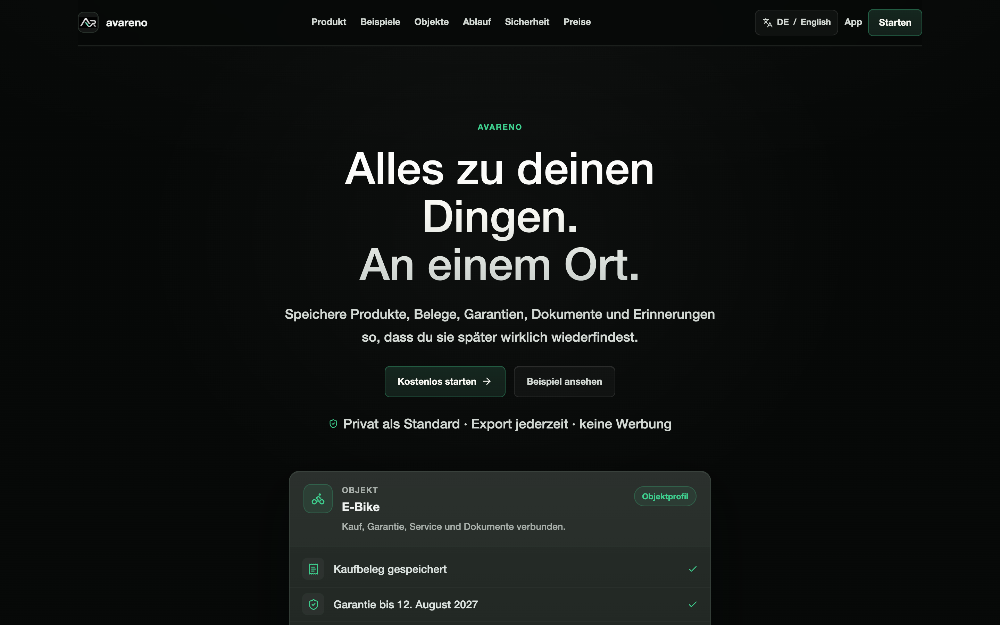

# Avareno

Web app (with an Expo mobile app in progress) that keeps everything about the things you own in one place: products, receipts, warranties, documents, repairs and reminders. Built for private households who want to find a receipt or warranty date again when they need it. Currently in closed beta (`0.1.0-beta.1`).



## Features

- Item profiles linking purchase receipt, warranty, documents, serial number and service history; completeness score per item
- Receipt upload with field extraction: via the Claude API when `ANTHROPIC_API_KEY` is set, otherwise a deterministic mock
- Turns a pasted message (e.g. "du kimmst am freida oda?") into an in-app reminder; nothing is read from messengers automatically and nothing is sent
- "Today open" view with care tasks, warranty warnings and incomplete items; XP and levels for completed tasks
- Privacy endpoints: data summary, export, deletion request, deleting AI-related data
- Auth via Supabase (access tokens verified by the backend), subscriptions via Stripe (checkout, webhooks, cancel/reactivate)
- Local Home Assistant bridge as an early foundation for smart-home devices
- 39 backend tests (API, auth, documents, privacy)

## Tech stack

Backend: Python 3.12, FastAPI, SQLite · Frontend: React, TypeScript, Vite, Tailwind CSS · Mobile: Expo / React Native · Hosting: Cloudflare Pages (frontend), Fly.io with Docker (API) · Supabase Auth · Stripe

## Quick start

Local development needs no accounts; auth is only enforced with `AVARENO_REQUIRE_AUTH=1`.

```bash
python3.12 -m venv .venv && source .venv/bin/activate
pip install -r backend/requirements.txt -r backend/requirements-dev.txt
npm install
npm run db:init && npm run dev
```

Frontend: http://localhost:5173 · API docs: http://localhost:4000/docs

## Usage

```bash
npm run test:backend   # pytest suite
npm run build          # production frontend bundle
npm run verify         # type checks + tests + build
```

The signed-in app (`/app`) needs Supabase keys in `frontend/.env.local` and `backend/.env.local`; see [docs/auth-foundation.md](docs/auth-foundation.md).

## Project structure

```
backend/app/
├── routers/     REST endpoints (items, capture, extract, loops, privacy, billing, ...)
├── services/    extraction, message parser, XP, billing, storage, smart home
├── auth.py      Supabase token verification
└── db.py        SQLite schema and access
backend/tests/   pytest suite
frontend/src/    React app and landing page
mobile/          Expo app (separate npm project)
functions/       Cloudflare Pages middleware and /api proxy
bridge/          local Home Assistant bridge
docs/            development, deployment, security and beta docs
```

## Technical decisions

The frontend runs on Cloudflare Pages while the FastAPI backend runs as a Docker container on Fly.io with SQLite on a persistent volume; a Pages function proxies `/api/*` and deliberately returns `501` when no backend is configured, so payment webhooks can never appear successful by accident. Because SQLite is file-based, the API is pinned to exactly one machine. AI extraction is an explicit user action behind a single service boundary, with a mock fallback so tests and local development never need an API key.

## Possible extensions

- Encrypted storage before syncing real private data
- Moving storage to a managed database to allow more than one API instance
- Finishing the mobile app and the Home Assistant bridge

## More

Development, Cloudflare deployment and scripts: [docs/DEVELOPMENT.md](docs/DEVELOPMENT.md) · Fly.io: [docs/deploy-fly.md](docs/deploy-fly.md) · Changelog: [CHANGELOG.md](CHANGELOG.md)
